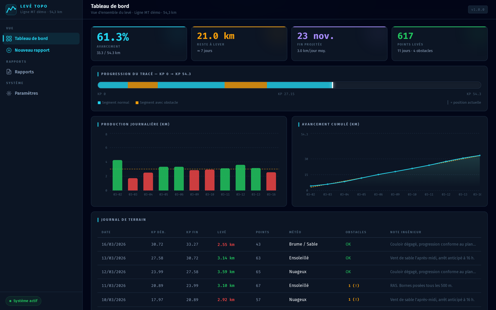
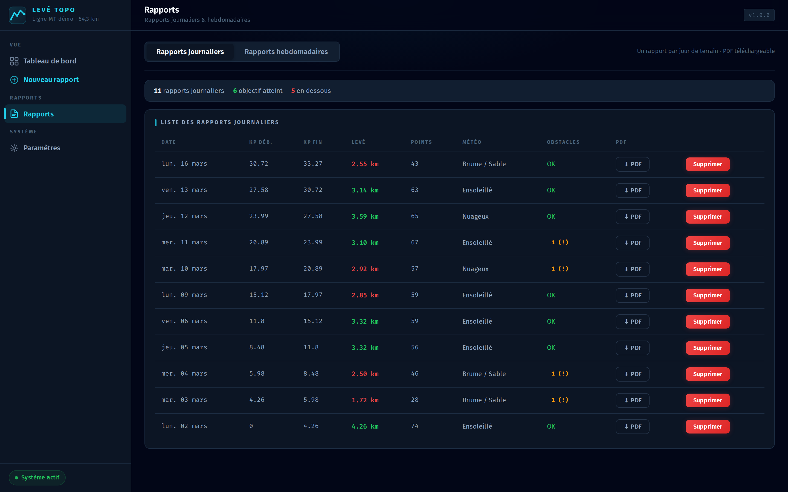
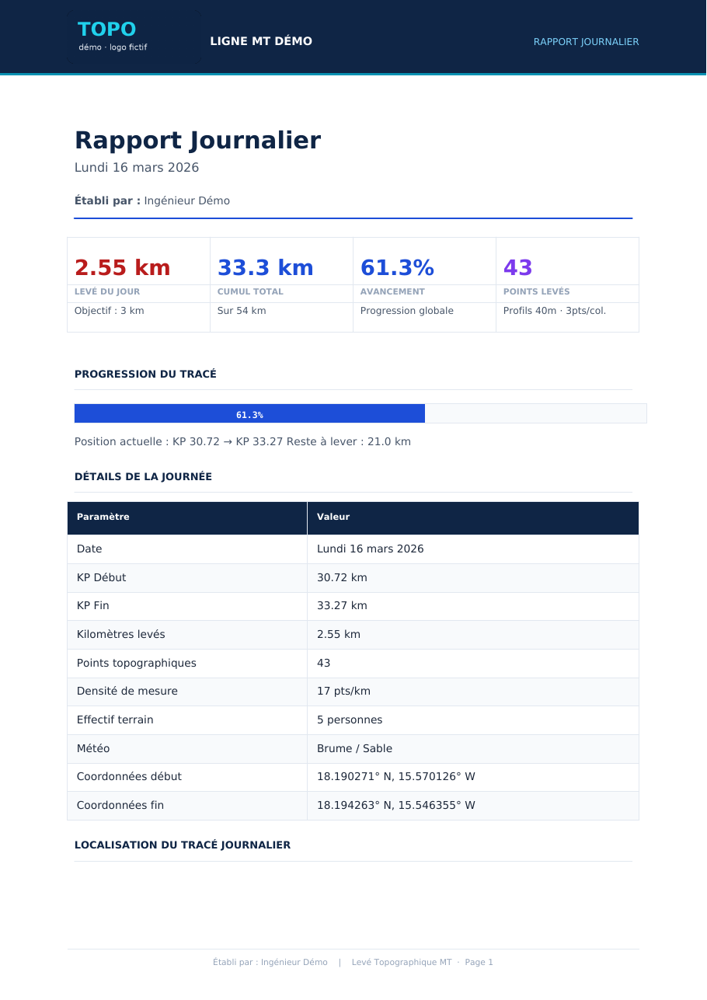
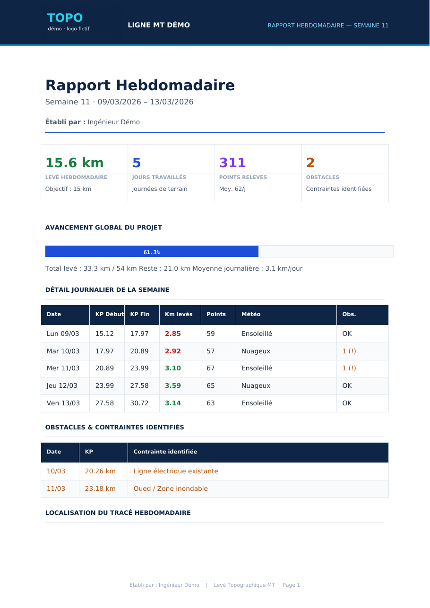
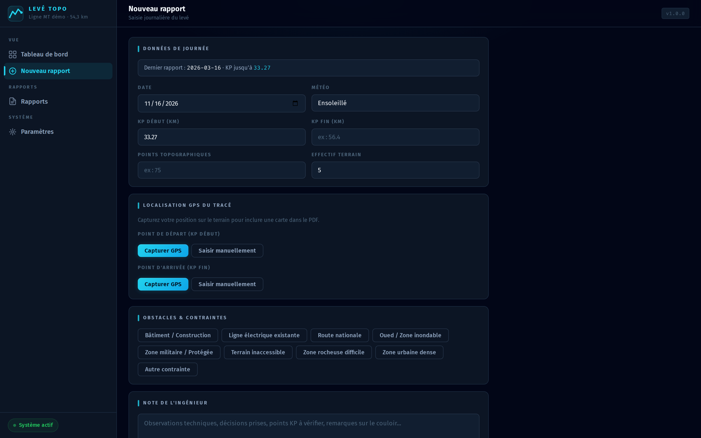
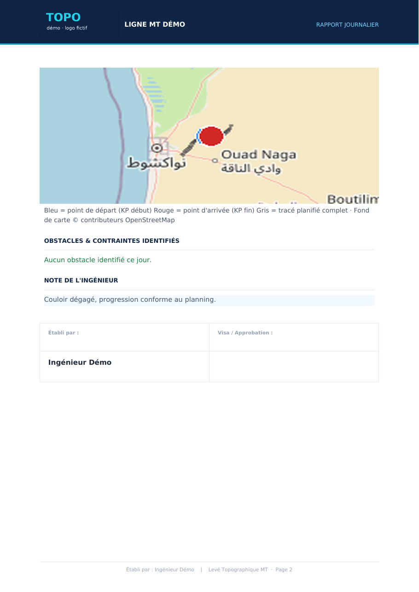
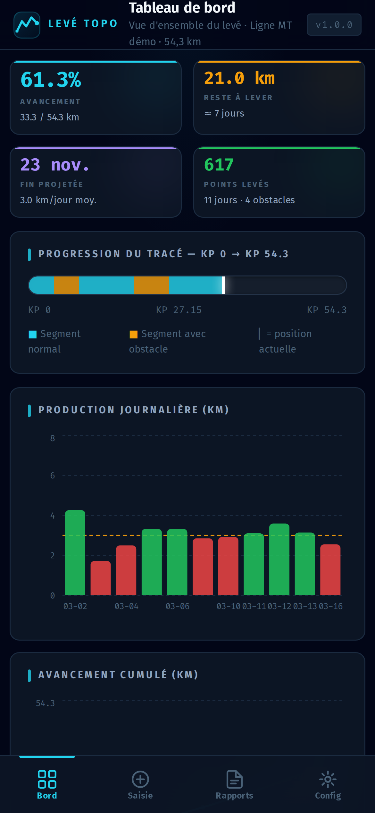

# Topo Survey: field reporting for power-line surveys

**A web app for topographic survey crews on long linear projects such as power lines. Each evening the crew enters the day's chainage (KP), and the app tracks progress against the route and produces client-ready daily and weekly PDF reports with a map of the surveyed section.**

FastAPI · SQLite · ReportLab · React · Vite · Recharts. The interface is in French, as used by the field team.



> All screenshots use a **fictional demo project** generated by [`scripts/seed_demo.py`](scripts/seed_demo.py): a synthetic route, a placeholder logo and invented reports. No real project data is included.

---

## The problem

On a power-line survey, crews cover a corridor tens to hundreds of kilometres long, a few kilometres a day. The site engineer has to send a **daily report** (chainage covered, points measured, crew, weather, obstacles, GPS position) and a **weekly summary**. They also need to answer "are we on schedule?" every day.

Done by hand in Word and Excel, this means:
- repetitive formatting every evening, often from a laptop in the field;
- progress figures recomputed by hand, with no single source of truth;
- no map, so the client can't see *where* the day's work happened.

## What it does

| | |
|---|---|
| **Daily entry** | Date, KP start/end, survey points, crew size, weather, obstacles (each with its KP), engineer's note, and GPS start/end captured from the phone or typed in. Validation rejects a KP end ≤ KP start and duplicate days. |
| **Dashboard** | Progress %, km remaining, projected end date at the current pace, daily production vs. target, cumulative progress vs. plan, and a strip of the route showing segments with obstacles. |
| **Daily PDF** | KPIs, progress bar, details table, a map of the day's section on OpenStreetMap tiles with the planned route, obstacles and notes, plus a signature block. |
| **Weekly PDF** | ISO-week summary: km vs. weekly target, a per-day table, obstacles with KP, and a map of the week. |
| **Route import** | Upload the corridor as KMZ/KML (from Google Earth or a GIS). Each line section is stored separately and simplified, then drawn on every report map. |
| **Settings** | Project name, total length, daily target, engineer name, and a logo that appears in the PDF header. |
| **Mobile** | Responsive layout with a bottom navigation bar, for entering reports on site from a phone. |

| Reports list | Daily PDF | Weekly PDF |
|---|---|---|
|  |  |  |

| New report | Map page of the daily PDF | Mobile |
|---|---|---|
|  |  |  |

## Results

Tested on three real project corridor files (KMZ exported from GIS; the files are not included):

| Corridor file | Size | Line sections | Vertices | Stored after simplification | Parse time |
|---|---|---|---|---|---|
| A | 6.6 KB | 17 | 239 | 171 | 0.01 s |
| B | 5.7 KB | 17 | 153 | 124 | 0.01 s |
| C | 8.6 MB | 3,147 | **1,111,664** | **6,295** (−99.4 %) | 6.1 s |

**Corrected route lengths.** The first version of the importer chained every coordinate in the file into one line, including pylon/marker points and the gaps between sections. It reported **834, 443 and 1,228 km** for these corridors. Measuring each line section separately gives **157, 126 and 175 km**. The same fix removed false zig-zags from the report maps, and the iterative Douglas–Peucker simplifier cut the largest file's parse time from 15.7 s to 6.1 s.

Other checks:
- **11 automated tests**: API CRUD and stats, ISO-week grouping (including a year boundary), daily and weekly PDF generation, KMZ/KML import (multi-section files, unsafe filenames, empty files), coordinate formatting.
- Deployed on a Linux VPS behind nginx, with systemd running the API ([`deploy/`](deploy/)).

## Tech stack

- **Backend:** FastAPI, SQLAlchemy 2, Pydantic 2, SQLite (or any SQLAlchemy URL)
- **PDF:** ReportLab with DejaVu fonts (full French typography), Pillow-stitched OpenStreetMap tiles
- **GIS:** KMZ/KML parsing, haversine lengths, Douglas–Peucker simplification, Web-Mercator tile maths
- **Frontend:** React 18, Vite 5, Recharts, react-hot-toast
- **Ops:** nginx (static frontend + API proxy), systemd, environment-based config
- **Tests:** pytest + FastAPI TestClient

## Project structure

```
topo-survey/
├── backend/
│   ├── main.py            # FastAPI routes: config, stats, reports, weeks, PDFs, route import
│   ├── models.py          # SQLAlchemy models (DailyReport, ProjectConfig)
│   ├── schemas.py         # Pydantic validation (KP ordering, obstacle format migration)
│   ├── database.py        # engine/session, data dir from env
│   ├── pdf_gen.py         # daily & weekly PDF reports, OSM tile maps
│   ├── route_parser.py    # KMZ/KML → simplified route segments
│   └── tests/
├── frontend/src/
│   ├── App.jsx            # shell, navigation, project label from settings
│   ├── pages/             # Dashboard, NewReport, Reports, Settings
│   └── components/ui.jsx
├── deploy/                # nginx site + systemd unit
├── scripts/
│   ├── seed_demo.py       # fictional demo project
│   └── screenshots.py     # README screenshots (Playwright)
└── samples/demo_route.kmz # synthetic route used by the demo
```

## How to run

### Backend

```bash
cd backend
python -m venv .venv && source .venv/bin/activate
pip install -r requirements.txt
uvicorn main:app --reload --port 8000        # API docs at http://localhost:8000/docs
```

### Frontend

```bash
cd frontend
npm install
npm run dev                                   # http://localhost:5173, /api proxied to :8000
```

### Demo data (optional)

```bash
cd backend
TOPO_DATA_DIR=../demo-data python ../scripts/seed_demo.py
TOPO_DATA_DIR=../demo-data uvicorn main:app --port 8000
```

### Configuration

All settings are environment variables; see [`.env.example`](.env.example).

| Variable | Default | Purpose |
|---|---|---|
| `TOPO_DATA_DIR` | `backend/data` | SQLite database, imported routes, uploaded logo |
| `DATABASE_URL` | SQLite in `TOPO_DATA_DIR` | any SQLAlchemy URL |
| `CORS_ORIGINS` | Vite dev server | comma-separated allowed origins |
| `MAP_TILES` | `on` | `off` to generate PDFs without a basemap (no network) |
| `MAP_TILE_URL`, `MAP_USER_AGENT` | OSM | tile server and an identifying User-Agent (see the [OSM tile policy](https://operations.osmfoundation.org/policies/tiles/)) |

### Tests

```bash
cd backend
pip install -r requirements-dev.txt
pytest
```

### Production

Build the frontend (`npm run build`) and serve `dist/` with nginx, which proxies `/api` to uvicorn running under systemd. Ready-made files are in [`deploy/`](deploy/). GPS capture in the browser requires HTTPS.

## Limitations

- **Single project, no authentication.** It is meant to run behind a VPN or HTTP basic auth on a private server.
- Progress is the furthest KP reached, which assumes the survey advances along the chainage.
- Report maps fetch OpenStreetMap tiles at PDF-generation time. Heavy use should point `MAP_TILE_URL` at your own tile server or a commercial provider.

## Author

Mohamedou Loughmane ([@MedouLoq](https://github.com/MedouLoq))

## License

[MIT](LICENSE). Map data © OpenStreetMap contributors (ODbL).
